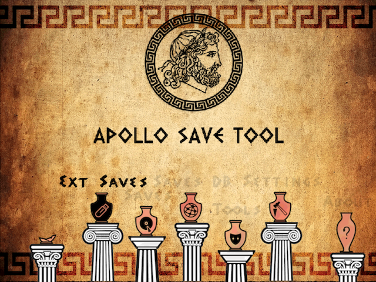

# Apollo Save Tool (Dreamcast)

[![Downloads][img_downloads]][app_downloads] [![Release][img_latest]][app_latest] [![License][img_license]][app_license]
[](https://github.com/bucanero/apollo-dc/actions/workflows/build.yml)

[](https://twitter.com/dparrino)

**Apollo Save Tool** is an application to manage save-game files on the Sega Dreamcast.

This homebrew app allows you to manage, back up, patch, and import save-game files on your Dreamcast VMUs (Visual Memory Units), directly on the console.



**Comments, ideas, suggestions?** You can [contact me](https://github.com/bucanero/) on [Twitter](https://twitter.com/dparrino) and on [my website](http://www.bucanero.com.ar/).

# Features

* **Easy to use:** no advanced setup needed.
* **Standalone:** no computer required, everything happens on the Dreamcast.
* **Self-booting disc:** the app, the save patches and the Saves DB on a single `.cdi` image.
* **Settings on the VMU:** your settings are kept in a small `APOLLO__OPTS` file (2 blocks), found on any VMU at startup.

## VMU Save Management

* **Save files listing:** quick access to the saves on any VMU plugged into a controller, with their titles and icons (+ file details).
  - Japanese save titles are shown using the Dreamcast BIOS font.
* **Save files patching:** complete support for Apollo [save patches](https://github.com/bucanero/apollo-patches) to enhance your save-games. The VMS CRC is updated as needed.
* **Hex editor:** edit any save file byte by byte.
* **Copy saves:** copy save files between VMUs.
* **Save import/export:** export saves to `.DCI` (Nexus) and `.VMI`/`.VMS` formats, and import `.DCI` and `.VMI`/`.VMS` saves from SD card or PC.
* **Delete saves:** remove any save file stored on a VMU.
* **Bulk management:** copy or export all (or only the selected) saves in one go.

## VMU Memory Card Backup

* **Full VMU dumps:** read every block of a VMU into a raw 128 KB `.BIN` image, as a complete memory card backup.
  - The images work with [apollo-ps3](https://github.com/bucanero/apollo-ps3)'s virtual VMU support, [DCVMU Tool](https://github.com/bucanero/dcvmu-tool), and emulators like Flycast.

## Saves Database

* **Offline Saves DB:** browse the [Apollo saves database](https://github.com/bucanero/apollo-saves) of Dreamcast save-games, stored on the disc, and import them straight to a VMU.

# Download

Get the [latest version here][app_latest].

Development builds of every commit are available in the [GitHub Actions](https://github.com/bucanero/apollo-dc/actions/workflows/build.yml) page (`apollo-dc.cdi`, `APOLLO-DC.elf` and `APOLLO-DC.BIN`).

## Changelog

See the [latest changes here][changelog].

# Donations

My GitHub projects are open to a [sponsor program](https://patreon.com/dparrino). If you feel that my tools helped you in some way or you would like to support it, you can consider a [PayPal donation](https://www.paypal.me/bucanerodev).

# Setup instructions

No special setup is needed. Just follow these simple steps:
1. Download the latest `apollo-dc.cdi` disc image.
2. Burn it to a CD-R, or copy it to your optical drive emulator (GDEMU, MODE, ...).
3. Boot the disc on your Dreamcast.

You can also run the app on an emulator like [Flycast](https://github.com/flyinghead/flycast), load `APOLLO-DC.elf` with [dcload](https://github.com/sizious/dcload-ip), or start `APOLLO-DC.BIN` from [DreamShell](https://github.com/DC-SWAT/DreamShell) (open it in the file manager, or run `exec -b -f <path>/APOLLO-DC.BIN`).

To import and export save files, an SD card adapter (FAT formatted) is supported. When running from dcload, the PC is also available as storage.

## Data folders

| Dreamcast | Folder |
|-----|--------|
| **VMU saves** | VMUs plugged into the controllers (`/vmu/a1/`, `/vmu/a2/`, ...) |
| **External saves** | `<sd/pc>:/DC/SAVEDATA/` (`*.dci`, `*.vmi` + `*.vms`) |
| **VMU images** | full VMU dumps are saved to `<sd/pc>:/DC/VMU/` (`*.bin`) |
| **Saves DB** | `/cd/SAVEDB/DC/` on the disc; `<sd/pc>:/SAVEDB/DC/` are used when the disc has none |
| **App data** | save patches and the VMU file name catalog, in `/cd/APOLLO/DATA/` on the disc |
| **Settings** | `APOLLO__OPTS` file, on the VMU it was loaded from (or the first VMU found) |

# Usage

Using the application is simple and straight-forward:

 - Move <kbd>UP</kbd>/<kbd>DOWN</kbd> to select the save-game file you want to patch, and press . The patch screen will show the available fixes for the file. Select the patches and click `Apply Changes`.
 - To view the item's details, press .
 - Press  to go back.
 - To reload the list, press .
 - Press <kbd>START</kbd> to select a save for the bulk operations (`Bulk Save Management`).
 - Press <kbd>LEFT</kbd>/<kbd>RIGHT</kbd> to move 5 items up or down, or the <kbd>L</kbd>/<kbd>R</kbd> triggers to move 25.

When more than one VMU is plugged in, the app asks which one to open.

# Saves Database

The application also provides direct access to the [Apollo saves database](https://github.com/bucanero/apollo-saves) of save-game files for Dreamcast games, stored on the disc image.
These usually offer additional features such as completed games that can save you many hours of playing.

To use a newer copy of the database without burning a new disc, copy the `DC/` folder of the [apollo-saves](https://github.com/bucanero/apollo-saves) repository to `SAVEDB/DC/` on your SD card.

The Saves DB project aims to [add more save-games](https://github.com/bucanero/apollo-saves/issues/new/choose) shared by the community.

# FAQs

 1. Where I can get a save-game for *XYZ game*?

    The Saves DB includes the [dreamcast-saves](https://github.com/bucanero/dreamcast-saves) collection. You can also check sites like [GameFAQs](https://gamefaqs.gamespot.com/dreamcast/). Searching on [Google](http://www.google.com) might help too.
 1. I have a save-game file that I want to share. How can I upload it?

    If you have a save file that is not currently available on the Saves DB and want to share it, please check [this link](https://github.com/bucanero/apollo-saves) for instructions.
 1. Why is it called **Apollo**?

    [Apollo](https://en.wikipedia.org/wiki/Apollo) was the twin brother of [Artemis](https://en.wikipedia.org/wiki/Artemis), goddess of the hunt. Since this project was born using the [Artemis-GUI](https://github.com/Dnawrkshp/ArtemisPS3/) codebase, I decided to respect that heritage by calling it Apollo.

# Credits

* [Bucanero](https://github.com/bucanero): Project developer

## Acknowledgments

* [Dnawrkshp](https://github.com/Dnawrkshp/): [Artemis PS3](https://github.com/Dnawrkshp/ArtemisPS3)
* [Berion](https://www.psx-place.com/members/berion.1431/): GUI design
* [Ross Meikleham](https://github.com/RossMeikleham): [FUSE-VMU](https://github.com/RossMeikleham/FUSE-VMU) (VMU filesystem)
* [KallistiOS](https://github.com/KallistiOS/KallistiOS) team: Dreamcast development kit
* [GPF](https://github.com/GPF): [SDL2 Dreamcast port](https://github.com/GPF/SDL/tree/dreamcastSDL2)
* [Simulant](https://gitlab.com/simulant): [GLdc](https://gitlab.com/simulant/GLdc) and [mkdcdisc](https://gitlab.com/simulant/mkdcdisc)
* [Nobody/Wild Light](https://github.com/nobodo): [S3M music track](https://github.com/bucanero/apollo-dc/blob/main/data/haiku.s3m)

# Building

You need to have installed:

- [KallistiOS](https://github.com/KallistiOS/KallistiOS) toolchain and [kos-ports](https://github.com/KallistiOS/kos-ports) (zlib, libpng, libzip, freetype, curl, [GLdc](https://gitlab.com/simulant/GLdc))
- [SDL2](https://github.com/GPF/SDL/tree/dreamcastSDL2) for Dreamcast (`dreamcastSDL2` branch)
- [Apollo](https://github.com/bucanero/apollo-lib) library
- [dbglogger](https://github.com/bucanero/dbglogger) library
- [mkdcdisc](https://gitlab.com/simulant/mkdcdisc), to build the disc image

> [!TIP]
> The [GitHub Actions workflow](.github/workflows/build.yml) builds the whole toolchain from scratch, and can be used as a reference.

Run `kos-cmake -S . && make` to create `APOLLO-DC.elf`, and the unscrambled `APOLLO-DC.BIN`.

To build the self-booting `apollo-dc.cdi` disc image, with the [save patches](https://github.com/bucanero/apollo-patches) and the [Saves DB](https://github.com/bucanero/apollo-saves), run `make cdi`. By default, it expects `apollo-patches` and `apollo-saves` to be checked out next to this repository; you can point to other locations, and to `mkdcdisc`, with:

```
kos-cmake -S . -D APOLLO_PATCHES_DIR=<path> -D APOLLO_SAVES_DIR=<path> -D MKDCDISC=<path to mkdcdisc>
```

Debug messages are written to the Dreamcast serial console (dcload, or Flycast's serial console option).

# License

[Apollo Save Tool](https://github.com/bucanero/apollo-dc/) (Dreamcast) - Copyright (C) 2020-2026 [Damian Parrino](https://twitter.com/dparrino)

This program is free software: you can redistribute it and/or modify
it under the terms of the [GNU General Public License][app_license] as published by
the Free Software Foundation, either version 3 of the License, or
(at your option) any later version.

[app_downloads]: https://github.com/bucanero/apollo-dc/releases
[app_latest]: https://github.com/bucanero/apollo-dc/releases/latest
[app_license]: https://github.com/bucanero/apollo-dc/blob/main/LICENSE
[changelog]: https://github.com/bucanero/apollo-dc/blob/main/CHANGELOG.md
[img_downloads]: https://img.shields.io/github/downloads/bucanero/apollo-dc/total.svg?maxAge=3600
[img_latest]: https://img.shields.io/github/release/bucanero/apollo-dc.svg?maxAge=3600
[img_license]: https://img.shields.io/github/license/bucanero/apollo-dc.svg?maxAge=2592000
